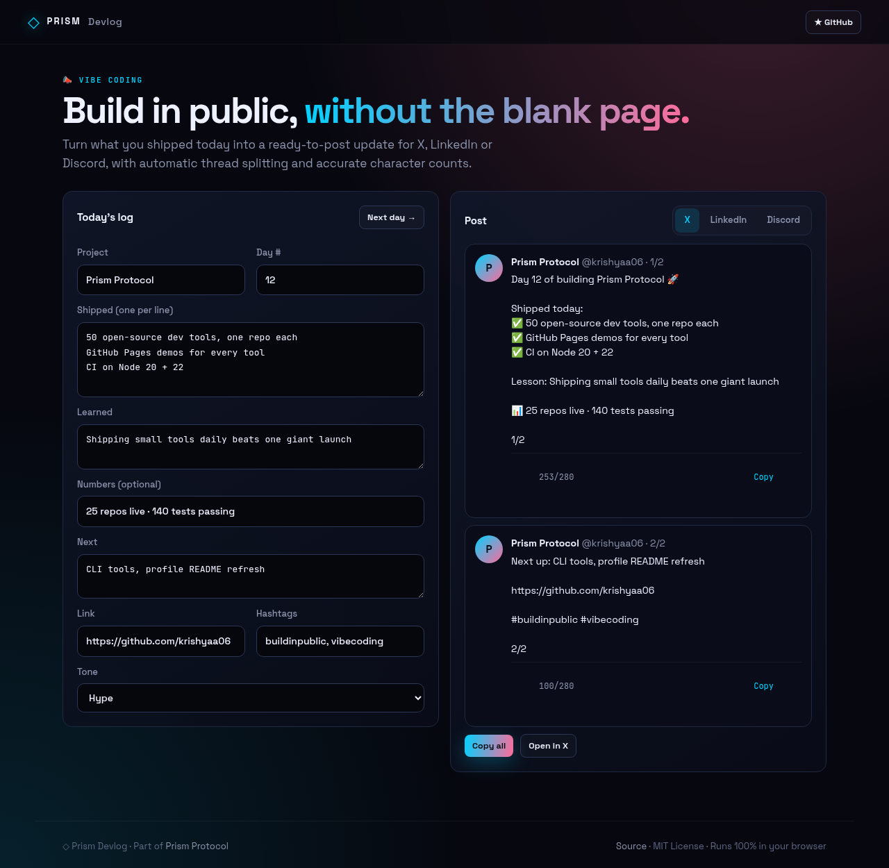
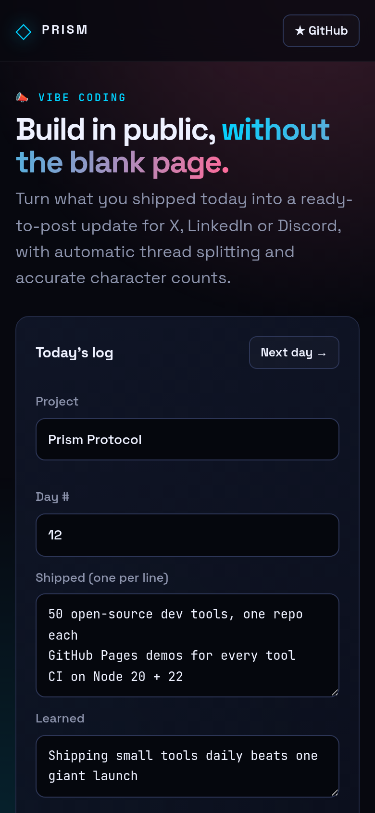

<!-- ═════════════ HEADER ═════════════ -->
<p align="center">
  
</p>

<p align="center">
  
</p>

<p align="center">
  <a href="https://github.com/krishyaa06/prism-devlog/actions/workflows/ci.yml"></a>
  <a href="https://krishyaa06.github.io/prism-devlog/"></a>
  
  
  <a href="LICENSE"></a>
</p>

<p align="center">
  
</p>


## ⚡ Overview

**Prism Devlog** removes the friction from posting build-in-public updates. Fill in what you shipped, what you learned, a stat or two and what's next, choose a tone, and get a post formatted for X, LinkedIn or Discord. Long X posts are split into a numbered thread at sentence boundaries, and character counts follow X's rules (URLs count as 23, emoji as 2). **Next day →** carries tomorrow's plan forward.

## ✨ Features

- **3 platforms** — X, LinkedIn, Discord (bold title, link embeds suppressed)
- **Auto thread splitting** under 280 with `1/n` numbering
- **X-accurate counting** — URLs = 23 chars, emoji = 2
- **3 tones**: hype, chill, professional
- **Day counter** + **Next day →** that rolls "next" into "shipped"
- Preview cards, copy per post or whole thread, open in X compose

## 📸 Screenshots

<table>
  <tr>
    <td width="68%"></td>
    <td width="32%"></td>
  </tr>
</table>

## 🚀 Quick Start

**Use it online:** [https://krishyaa06.github.io/prism-devlog/](https://krishyaa06.github.io/prism-devlog/)

**Run locally:**

```bash
git clone https://github.com/krishyaa06/prism-devlog.git
cd prism-devlog
# open index.html in your browser, or serve it:
npx serve .
```

## 🛠️ Usage

1. Fill in project, day, shipped / learned / next, link and hashtags.
2. Pick a platform and tone; read the preview.
3. Copy each post (or **Open in X**). Tomorrow, hit **Next day →**.

## 📁 Project Structure

```
prism-devlog/
├── assets/
│   ├── logo.png
│   └── logo.svg
├── css/
│   ├── app.css
│   └── prism.css
├── js/
│   ├── app.js   # form + previews
│   ├── core.js   # post builder, X length, thread splitter — tested in Node
│   └── prism.js
├── test/
│   └── core.test.js
├── .gitignore
├── LICENSE
├── index.html
└── package.json
```

## 🧪 Tests

```bash
npm test
```

Tests use the built-in `node:test` runner, so there is nothing to install. CI runs them on Node 20 and 22.

## 🤝 Contributing

1. Fork the repo and create a branch: `git checkout -b feature/my-idea`
2. Make your change and add a test in `test/`
3. Run `npm test` and open a Pull Request

## 🔷 Part of Prism Protocol

Prism Devlog is one of the open-source tools built by [Prism Protocol](https://dc.gg/prismprotocol), a tech community where young builders learn, ship and compete together.

## 👤 Author

<table>
  <tr>
    <td align="center">
      <a href="https://github.com/krishyaa06"><br><b>Soumya Bhandare</b></a><br>
      <sub>Founder @ Prism Protocol</sub>
    </td>
    <td>
      <a href="https://dc.gg/prismprotocol"></a><br>
      <a href="https://instagram.com/prism_protocol_"></a><br>
      <a href="https://x.com/krishyaa06"></a>
    </td>
  </tr>
</table>

## 📄 License

Released under the [MIT License](LICENSE).

<p align="center">
  <b>If you like this project, consider giving it a ⭐</b><br>
  <sub>"Build. Create. Compete." · Made with ⚡ by Prism Protocol</sub>
</p>


